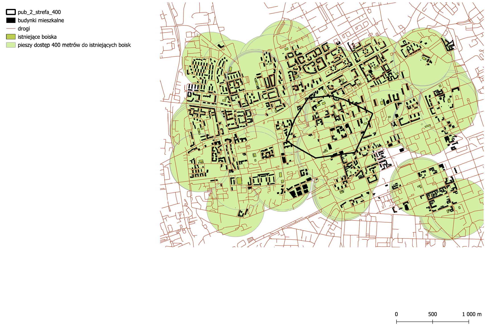
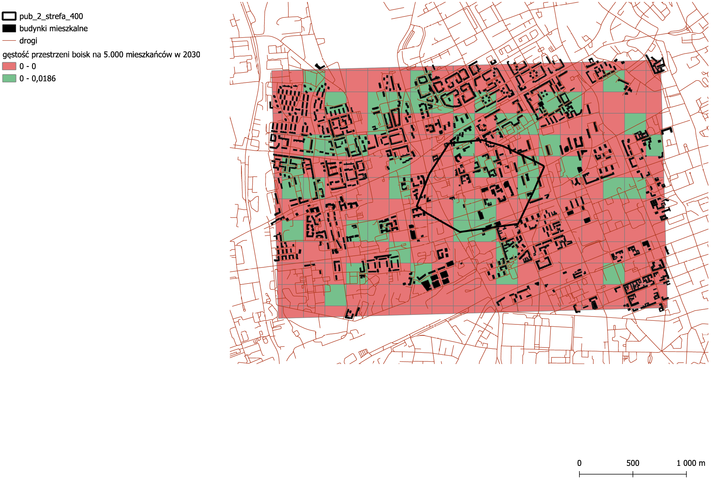
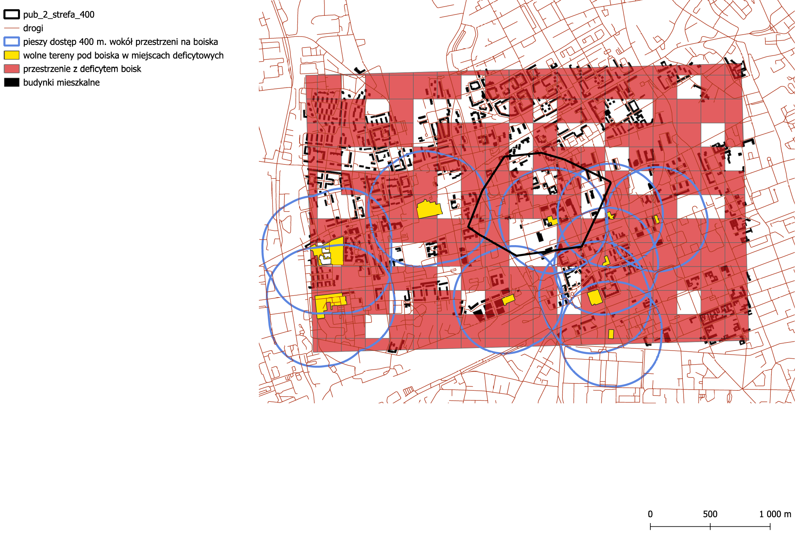
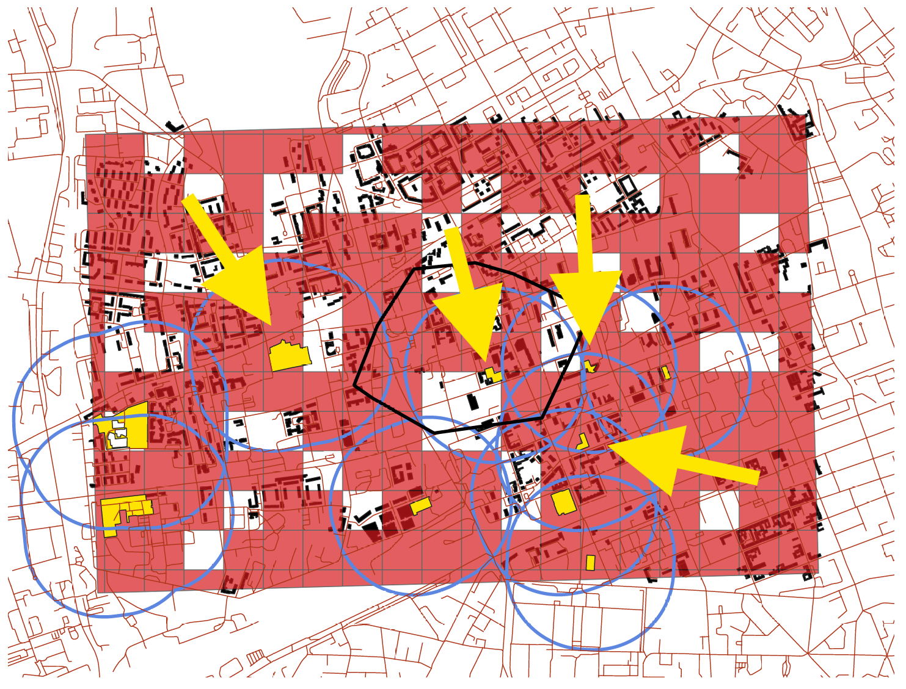

# Spatial Analysis of Sports Infrastructure Deficits: Warsaw (Browary Warszawskie Context)

**Author:** [Michał Foit](https://www.linkedin.com/in/michal-foit/)  
**Project Phase:** Analysis 18_F7 (Part 1 of 3)

## 📌 Project Overview
This repository contains **Analysis 18_F7**, part of a broader three-part spatial and statistical analysis project focused on the 400-meter pedestrian walking zone around "Browary Warszawskie" (Grzybowska 60, Warsaw) and its broader urban context. 

The goal of this specific analysis is to identify areas suffering from a deficit of accessible sports fields and to evaluate the land's suitability for constructing new facilities, factoring in demographic projections for the year 2030.

## 🎯 Objectives
*   Evaluate the pedestrian accessibility (400m radius) of existing sports fields.
*   Project future infrastructure demand using population growth estimates for 2021-2030.
*   Identify optimal urban spaces (primarily brownfields) for the strategic placement of new sports fields to alleviate future overcrowding.

## 🛠️ Methodology & Tools
The analysis was conducted using QGIS and relies on spatial data from OpenStreetMap (OSM) and demographic data from Statistics Poland (GUS).

**Key GIS Tools & Algorithms Used:**
*   Vector Grid creation (200x200m)
*   Buffer (400m)
*   Join Attributes by Location
*   Centroids & Zonal Statistics
*   Field Calculator

## 🧹 Data Processing & Quality Assurance
To ensure a high-quality analysis, several data processing steps were implemented:
1.  **Topology Correction:** Source data from OSM was cleaned of topological errors using the *Fix Geometries* algorithm.
2.  **Demographic Downscaling:** To fit broader demographic data into a precise 200x200m grid, population data from larger quadrants was proportionally divided by 25 using the Field Calculator.
3.  **Spatial Joins:** To prevent artificial data duplication (cloning) when assigning data to the new grid, a strict "one-to-one" spatial join was applied, fetching attributes based on the largest overlap.
4.  **Mathematical Safety:** To prevent critical division-by-zero errors in uninhabited areas (e.g., office districts, abandoned buildings), the `NULLIF()` function was utilized during indicator calculations.

## 📊 Results and Visualizations

### 1. Current Accessibility
The map below illustrates the pedestrian accessibility (400m buffer) of currently existing sports fields.

### 2. Projected Demand (2030)
This map highlights the accessibility of sports fields based on a ratio of 1 field per 5,000 residents projected for 2030. 
**Conclusion:** The overall accessibility in the study area is inadequate. Existing fields risk severe user overload by 2030. While some adequately serviced areas exist, they are heavily outweighed by the deficient zones (marked in red).

### 3. Land Suitability & Deficit Areas
This map isolates grid squares where the resident density per sports field falls below the 5,000 threshold. The yellow areas represent spaces potentially suitable for new construction. Because the study area is in the densely built center of Warsaw, there is a lack of completely undeveloped land. Therefore, the highlighted areas are primarily *brownfields* requiring reclamation.

### 4. Strategic Proposals
Based on the analysis, strategic locations (indicated by yellow arrows) have been proposed for new sports fields. Developing these specific sites would maximize accessibility, reduce the load on existing infrastructure, and specifically address the severe deficit in the south-eastern sector of the study area.

